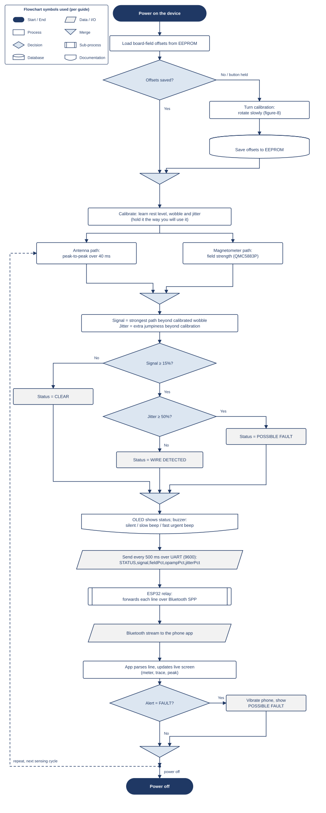

# EMF Wire Fault Detector

A handheld capstone project that senses electric and magnetic fields to find
wires inside walls — and flags likely faults (arcing, loose joints) — without
ever touching the wiring. The phone shows the live reading over Bluetooth.

**This repository contains the complete project: firmware, backend, and frontend code.**

| Part | Folder | What it is |
|------|--------|------------|
| **Firmware** | [`firmware/`](firmware/) | Arduino Uno sketch. Reads the sensors, runs the self-calibration and the Clear / Wire / Fault classification, drives the OLED and buzzer, and streams status lines to the ESP32. |
| **Backend** | [`backend/`](backend/) | ESP32 relay sketch. The gateway between the sensor and the phone: receives the Uno's serial stream and serves it to any client over Bluetooth Classic (SPP). |
| **Frontend** | [`frontend/EMFReader/`](frontend/EMFReader/) | Android app (**EMF-SENSE**, Kotlin + Jetpack Compose). Connects to the relay, decodes the protocol, and shows live readings, history trace, and alerts. |

## System architecture

```
 ┌──────────────────────────┐   UART 9600 baud   ┌───────────────────────┐   Bluetooth Classic   ┌─────────────────────┐
 │  Arduino Uno             │  D3 ──[divider]──► │  ESP32                │   SPP (RFCOMM)        │  Android phone      │
 │  firmware/               │  D2 ◄───────────── │  backend/             │ ◄───────────────────► │  frontend/EMFReader │
 │                          │  GND ◄──────────►  │                       │   "EMF_Wire_Detector" │  app "EMF-SENSE"    │
 │  antenna+op-amp, QMC5883P│                    │  UART2 ↔ BT relay     │   PIN 1234            │  live UI + alerts   │
 │  OLED, buzzer, button    │                    │                       │                       │                     │
 └──────────────────────────┘                    └───────────────────────┘                       └─────────────────────┘
```

The Arduino sends a status line every 500 ms, the ESP32 simply forwards it
line-by-line, and the app parses both this current format and older debug
formats so boards flashed with earlier sketches still work.

## How it works

Two independent sensing paths run at once:

1. **Antenna + op-amp (electric field).** An antenna feeds an LM358 gain
   stage; its output goes to `A0`. Measured as the peak-to-peak swing over a
   40 ms window — picks up mains hum and arcing.
2. **QMC5883P magnetometer (magnetic field).** Measures the field strength
   around a wire, including steady DC current, as the change from the
   calibrated rest value. Using the field *strength* means turning or tilting
   the board does not count.

Nothing is hard-coded: calibration learns, for each path, the resting level,
how much the reading naturally wobbles, and how much it jumps between
readings. Only changes beyond that learned wobble count as a signal; only
extra jumpiness beyond what was learned counts as jitter.

Classification (on the Arduino, mirrored by the app):

| Status | Condition |
|--------|-----------|
| **Clear** | headline signal below 15% |
| **Wire Detected** | signal ≥ 15%, steady |
| **POSSIBLE FAULT** | signal ≥ 15% and jitter ≥ 50% (a proxy for arcing / loose joints) |

The headline signal is the stronger of the two paths. Output goes to the OLED,
the buzzer (slow beep for wire, fast urgent beep for fault), and the status
line sent to the ESP32.

## Repository layout

```
EMF-Wire-Fault-Detector/
├── firmware/
│   └── EMF_Wire_Fault_Detector_v11/
│       └── EMF_Wire_Fault_Detector_v11.ino   # Arduino Uno sketch
├── backend/
│   └── ESP32_BT_Relay_2/
│       └── ESP32_BT_Relay_2.ino              # ESP32 Bluetooth relay sketch
├── frontend/
│   └── EMFReader/                            # Android Studio project
│       ├── app/src/main/                     # Kotlin + Compose sources
│       ├── app/src/test/                     # unit tests
│       └── app/src/androidTest/              # UI tests
├── docs/                                     # project documentation
│   ├── api-specification.md
│   ├── data-schema.md
│   ├── validation-report.md
│   ├── adr/                                  # architecture decision records
│   ├── erd.svg / .png                        # entity-relationship diagram
│   ├── flowchart.svg / .png                  # system flowchart
│   └── flowchart-firmware.svg / .png         # firmware logic flowchart
└── README.md
```

## Project documentation

All formal project documents live in [`docs/`](docs/):

| Document | What it covers |
|---|---|
| [API specification](docs/api-specification.md) | The integration interface: Bluetooth SPP service, authentication (fixed PIN 1234), message formats, timing limits, failure taxonomy, firmware compatibility |
| [Data schema](docs/data-schema.md) + [ERD](docs/erd.svg) ([PNG](docs/erd.png)) | Data dictionary and Chen-notation entity-relationship diagram: readings, sessions, devices, alert levels and the EEPROM calibration layout — each mapped to the store it really lives in |
| [Architecture Decision Records](docs/adr/) | Five ADRs: why Bluetooth Classic SPP, the two-board edge design, self-calibrating thresholds, the magnetometer handheld approach, and the monorepo |
| [Validation report](docs/validation-report.md) | Test plan with fillable result tables: performance, interoperability, reliability, and low-voltage fault-injection tests |
| [System flowchart](docs/flowchart.svg) ([PNG](docs/flowchart.png)) | End-to-end flow: power-on → calibration → sensing → classification → relay → phone |
| [Firmware flowchart](docs/flowchart-firmware.svg) ([PNG](docs/flowchart-firmware.png)) | How one sensing cycle processes the signals and decides Clear / Wire / Fault |



## Hardware and wiring

**Arduino Uno**

| Signal | Pin |
|--------|-----|
| Op-amp output (antenna path) | `A0` |
| QMC5883P magnetometer — SDA / SCL (I2C, address `0x2C`) | `A4` / `A5` |
| SSD1306 OLED 128×64 — SDA / SCL (I2C, address `0x3C`, `0x3D` fallback) | `A4` / `A5` |
| Buzzer module (3-pin: VCC, GND, I/O; active-low by default) | `8` |
| Push button to GND (internal pull-up) | `7` |
| Link to ESP32 — TX via voltage divider | `D3` |
| Link to ESP32 — RX | `D2` |

The OLED and the magnetometer share the same two I2C wires; that works because
their addresses differ (`0x3C` vs `0x2C`).

**Link to the ESP32 (mind the voltage)**

- Arduino `D3` (TX, 5 V) → **voltage divider down to 3.3 V** → ESP32 `GPIO16` (RX2)
- Arduino `D2` (RX) ← ESP32 `GPIO17` (TX2) — direct, no divider needed
- Arduino `GND` ↔ ESP32 `GND` — required, even though the ESP32 is powered
  separately (e.g. a power bank over USB)

## Data protocol

The Arduino emits one line every 500 ms at 9600 baud:

```
STATUS,signal,fieldPct,opampPct,jitterPct
```

e.g. `WIRE,44,0,44,20` — status word (`CLEAR` / `WIRE` / `FAULT`), headline
signal, magnetometer channel, op-amp channel, jitter. All percentages are
0–100. The app also understands the verbose debug lines of earlier sketch
versions, so older hardware keeps working. Full details — service UUID,
authentication, timing limits, failure taxonomy — are in the
[API specification](docs/api-specification.md).

## Getting started

### 1. Firmware — Arduino Uno

1. Open `firmware/EMF_Wire_Fault_Detector_v11/EMF_Wire_Fault_Detector_v11.ino` in the Arduino IDE.
2. Install via **Library Manager**: *Adafruit GFX Library* and *Adafruit SSD1306*.
   (The QMC5883P is read directly over `Wire`, no extra library needed.)
3. Select **Arduino Uno** and upload.

Serial Monitor (9600 baud): `c` re-runs calibration, `t` redoes the turning
step + calibration.

### 2. Backend — ESP32

1. Open `backend/ESP32_BT_Relay_2/ESP32_BT_Relay_2.ino` in the Arduino IDE.
2. Install the **esp32** board package (Espressif) via **Boards Manager**.
3. Select your ESP32 board and upload.
4. On the phone: pair with **`EMF_Wire_Detector`** (PIN **1234**) in the system
   Bluetooth settings.

### 3. Frontend — Android app

1. Open the `frontend/EMFReader` folder in Android Studio (recent version —
   the project uses AGP 9.3.3, Kotlin 2.2.10, compileSdk 36).
2. Run on a device (Android 7.0 / API 24 or newer), or build from the command
   line:

   ```bash
   cd frontend/EMFReader
   ./gradlew assembleDebug    # APK
   ./gradlew test             # unit tests
   ```

3. In the app: allow Bluetooth access, pick the paired sensor, and hold the
   phone near the detector. No readings are stored or sent anywhere — the app
   talks straight to the relay.

### Using the device

- **First power-up after assembly:** the OLED asks you to turn the device
  slowly in all directions (figure-8) for a few seconds. This learns the
  board's own fixed magnetism and is saved to EEPROM, so you only do it once.
- **Normal operation:** power up, hold the device the way you will use it, and
  wait out the countdown while it calibrates.
- **Recalibrate any time:** press the button, or send `c`. Hold the button
  while powering on (or send `t`) to redo the turning step.

## Safety

Never let the antenna wire or your hands touch exposed/live house wiring.
Sense from a safe distance, through the wall or insulation only. For
fault-vs-normal testing, use a low-voltage source or a de-energized frayed
cord — never live mains current.
